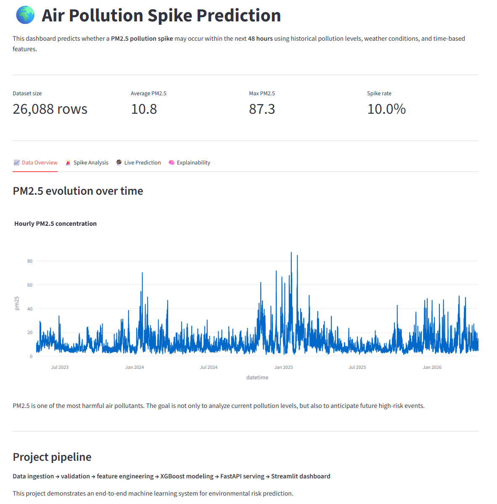
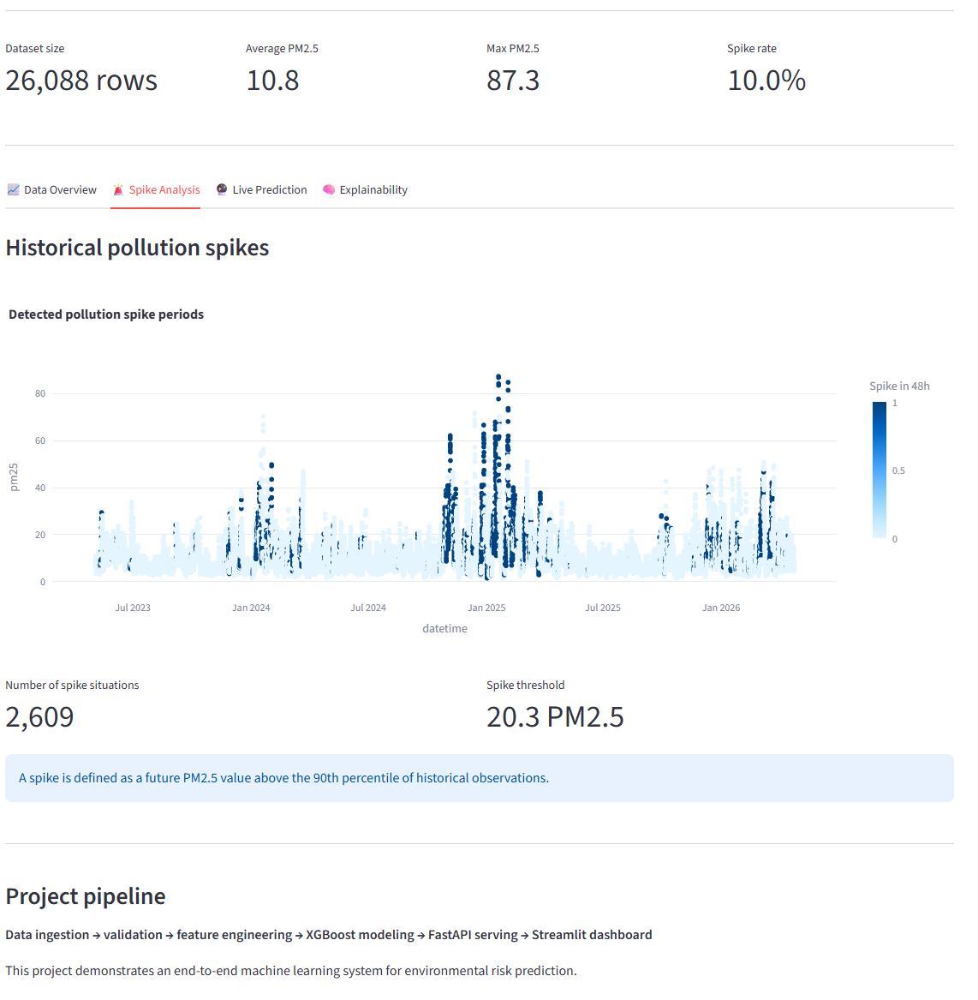
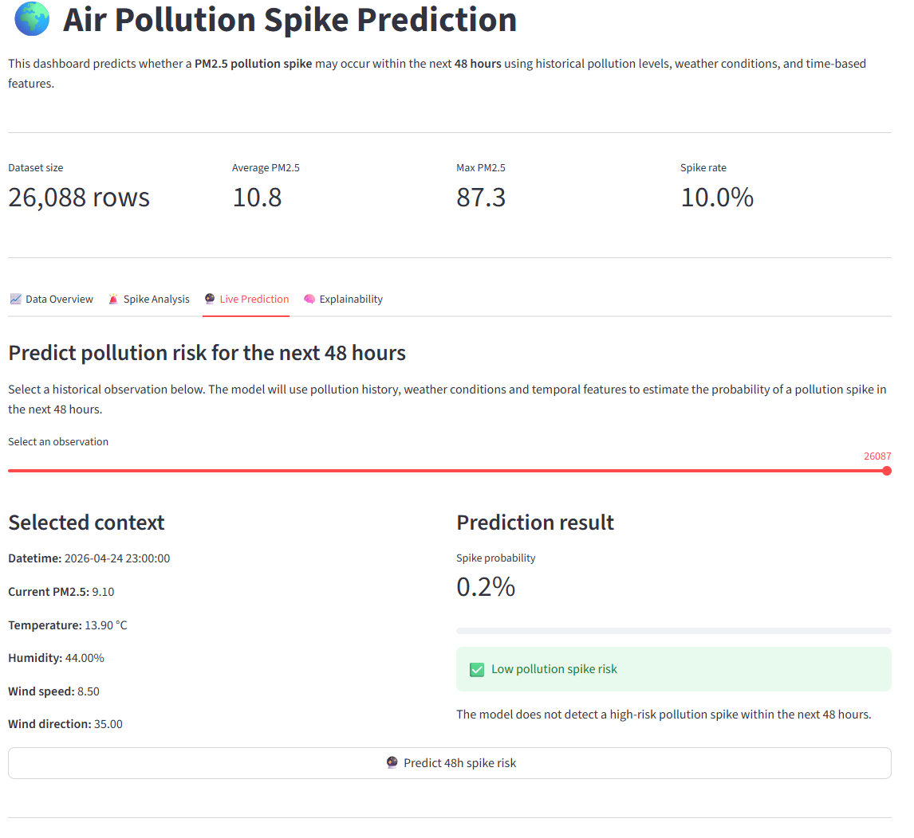
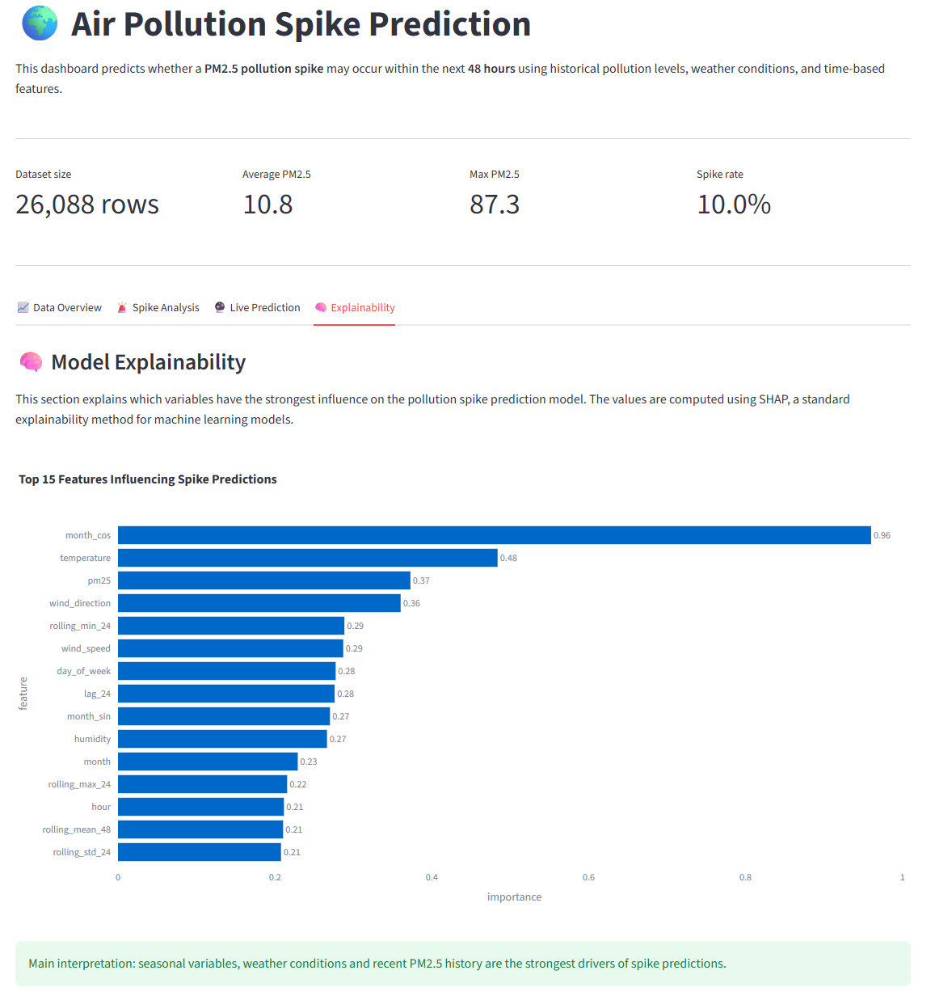

# 🌍 Air Pollution Spike Prediction System

An end-to-end Machine Learning system designed to predict air pollution spikes 48 hours in advance using historical PM2.5 measurements, weather conditions, and advanced time-series feature engineering.

---

# 🚀 Live Demo

| Service | URL |
| ------- | --- |
| 🌐 Streamlit Dashboard | [air-pollution-dashboard.onrender.com](https://air-pollution-dashboard.onrender.com) |
| ⚡ FastAPI Backend | [air-pollution-api.onrender.com](https://air-pollution-api.onrender.com) |
| 📖 Interactive API docs | [air-pollution-api.onrender.com/docs](https://air-pollution-api.onrender.com/docs) |

> ⏳ **Cold start warning.** Both services run on Render's free tier, which puts a
> container to sleep after 15 minutes without traffic. The **first request wakes it
> up and can take 50 to 60 seconds** (measured: 52 s). The link is not broken — it
> is booting. Reload once and everything responds normally.

---

# 📌 Project Overview

Air pollution is a major environmental and public health issue.
This project aims to anticipate severe PM2.5 pollution events 48 hours ahead using:

* historical pollution measurements
* meteorological conditions
* temporal patterns
* explainable machine learning

The system includes:

✅ Data ingestion pipeline
✅ Data validation pipeline
✅ Feature engineering for time-series forecasting
✅ XGBoost regression and classification models
✅ Rare-event spike detection
✅ Naive baselines to put every metric in context
✅ Explainability with SHAP
✅ FastAPI model serving
✅ Streamlit interactive dashboard
✅ Test suite and GitHub Actions CI
✅ Dockerized deployment
✅ Cloud deployment on Render

---

# 📸 Dashboard Screenshots

## Data Overview


## Spike Analysis


## Live Prediction


## Explainability


---

# 🏗️ System Architecture

```text
           ┌────────────────────┐
           │   Streamlit UI     │
           │  Dashboard Layer   │
           └─────────┬──────────┘
                     │ REST API
                     ▼
           ┌────────────────────┐
           │   FastAPI Backend  │
           │ Prediction Service │
           └─────────┬──────────┘
                     │
                     ▼
           ┌────────────────────┐
           │  XGBoost Models    │
           │ Regression + Spike │
           └─────────┬──────────┘
                     │
                     ▼
           ┌────────────────────┐
           │ Feature Engineering│
           │  Validation Layer  │
           └─────────┬──────────┘
                     │
                     ▼
           ┌────────────────────┐
           │ Multi-API Ingestion│
           │ Weather + Pollution│
           └────────────────────┘
```

---

# 📊 Dataset

## 🌫️ Air Quality Data

Source:

* Open-Meteo Air Quality API

Features:

* PM2.5 concentration

## 🌦️ Weather Data

Source:

* Open-Meteo Archive API

Features:

* temperature
* humidity
* wind speed
* wind direction

## ⏱️ Time Coverage

* hourly observations from **2023-05-04 to 2026-04-24**
* 26,088 rows after feature engineering and NaN removal

---

# 🧪 Evaluation Protocol

This is a time-series problem, so the evaluation is built to avoid temporal leakage:

* **Chronological 80 / 20 split — no shuffling, no random K-fold.**
  Training covers 20,870 hours (2023-05-04 → 2025-09-19), the test set covers the
  5,218 hours that follow (2025-09-19 → 2026-04-24). The models are never evaluated
  on a period they have seen.
* **No target-derived feature.** `spike_48h` is computed from `target_pm25_48h`, so
  it is excluded from the feature set of both models. A test in
  [tests/test_models.py](tests/test_models.py) asserts this invariant on every saved
  model, so the leak cannot come back silently.
* **Every metric is compared to a naive baseline** on the exact same test set.
  Regenerate the full comparison with `python -m src.models.baseline`
  → [reports/baseline_comparison.md](reports/baseline_comparison.md).

---

# 🧠 Machine Learning Tasks

## 1. PM2.5 Forecasting

Regression model predicting PM2.5 concentration 48 hours ahead.

### Model

* XGBoost Regressor

### Results vs baselines

| Model | MAE | RMSE | R² |
| ----- | --- | ---- | -- |
| Persistence (PM2.5 in 48h = PM2.5 now) | 6.57 | 9.41 | -0.400 |
| Smoothed persistence (24h rolling mean) | 6.59 | 9.10 | -0.311 |
| Climatology (training mean) | 5.76 | 8.02 | -0.018 |
| **XGBoost Regressor** | **5.90** | **7.93** | **0.005** |

**Reading these numbers honestly:** the model cuts RMSE by 16 % against the naive
persistence rule (9.41 → 7.93) and is the only candidate with a non-negative R².
But it does **not** beat a plain climatology baseline on MAE (5.90 vs 5.76). At a
48-hour horizon, with only past observations and no weather *forecast* as input,
predicting an exact hourly concentration is close to the ceiling of this feature
set. That is why the operational value of the system sits in the task below.

## 2. Pollution Spike Detection

Binary classification predicting whether a severe pollution spike — PM2.5 above the
90th percentile, 20.3 µg/m³ — will occur within 48 hours. Spikes represent 12.2 % of
the test set.

### Model

* XGBoost Classifier, `scale_pos_weight` for class imbalance, decision threshold 0.30

### Results vs baselines

| Model | Accuracy | Precision | Recall | F1 |
| ----- | -------- | --------- | ------ | -- |
| Spike persistence (spike now → spike in 48h) | 0.830 | 0.303 | 0.303 | 0.303 |
| Always "no spike" (majority class) | 0.878 | 0.000 | 0.000 | 0.000 |
| **XGBoost Classifier (threshold 0.30)** | 0.736 | 0.248 | **0.575** | **0.347** |

**Reading these numbers honestly:** the classifier catches **57.5 % of severe events
against 30.3 % for the naive rule** — nearly twice as many — and improves F1 (0.347
vs 0.303). Its accuracy is *lower* than the majority-class baseline, and that is
expected: on a 12 % positive class, answering "never a spike" scores 0.878 accuracy
while catching zero events. Accuracy is the wrong metric for this task.

### Business Optimization

The decision threshold was lowered to 0.30 to trade precision for recall: for a
public-health alert, a missed pollution spike costs far more than a false alarm.
On the test set this operating point catches 366 of the 636 real spikes at the cost
of 1,110 false alarms — roughly 3 false alarms per event caught. An explicit,
tunable trade-off rather than a default.

---

# ⚙️ Feature Engineering

All features are built in [src/data/transformation.py](src/data/transformation.py).

## Lag Features

* lag_1
* lag_3
* lag_6
* lag_12
* lag_24
* lag_48
* lag_72
* lag_168

## Rolling Statistics

* rolling_mean_6
* rolling_mean_12
* rolling_mean_24
* rolling_mean_48
* rolling_std_24
* rolling_max_24
* rolling_min_24

## Temporal Features

* hour
* day_of_week
* month
* weekend indicator

## Cyclic Encoding

* hour_sin / hour_cos
* month_sin / month_cos

## Weather Interaction Features

* temperature × humidity

---

# 🧠 Explainable AI

The system integrates SHAP explainability to understand which variables influence
pollution spike predictions ([src/models/explainability.py](src/models/explainability.py)).

Top influencing features include:

* seasonal patterns
* temperature
* historical PM2.5 trends
* wind conditions
* humidity

---

# 🌐 API Endpoints

## Health Check

```http
GET /
```

## PM2.5 Forecast

```http
POST /predict-regression
```

## Pollution Spike Prediction

```http
POST /predict-spike
```

Both prediction endpoints expect the 29 engineered features defined by the
`PollutionFeatures` schema. Interactive documentation is available at
[`/docs`](https://air-pollution-api.onrender.com/docs).

---

# 📊 Streamlit Dashboard

The dashboard includes:

✅ PM2.5 time-series visualization
✅ Historical spike analysis
✅ Real-time prediction interface
✅ SHAP explainability visualization
✅ Interactive UI

---

# ✅ Tests & CI

```bash
pip install -r requirements-dev.txt
pytest tests -q
```

The suite covers the API contract (health check, both prediction endpoints, input
validation) and two model invariants that protect against regressions actually hit
during development:

* the features expected by each saved model must match the API schema exactly;
* no model may consume a column derived from the target.

It also checks the promotion rule (including the real case of the current regressor,
which must not be promoted), the reproducibility of the ingestion window and, when
Airflow is installed, the structure of the DAG.

[GitHub Actions](.github/workflows/ci-cd.yml) runs the tests, regenerates the
baseline comparison and builds both Docker images on every push to `main`.

---

# 🔁 MLOps: MLflow Tracking & Airflow Orchestration

## Experiment tracking & Model Registry (MLflow)

Every training run is logged to MLflow:

* hyperparameters, training / test periods and dataset sizes;
* test metrics (MAE / RMSE / R² for the regressor, precision / recall / F1 and the
  confusion matrix for the classifier);
* **the naive baselines computed on the same test set, in the same run**, plus a
  `beats_best_baseline_*` tag, so no metric is ever read without its reference;
* the model itself, with its input signature, registered as a new **candidate
  version** in the Model Registry (`pm25-48h-regressor`, `pm25-spike-classifier`).

## Promotion rule

[`src/models/promote.py`](src/models/promote.py) gives the `champion` alias to the
latest version **only if, on the current test set**, it beats:

1. the best naive baseline, and
2. the current champion, re-evaluated on that same test set (a metric logged on an
   older test window would not be comparable, since the window moves with each
   retraining).

The decision and the scores behind it are stored as tags on the model version. A
promoted model is also exported to `models/*.json` (XGBoost's native, version-stable
format, rather than a pickle), which the API serves on Render.
With `MODEL_SOURCE=mlflow`, the API loads the champion straight from the registry.

> **Current status, stated honestly:** the spike classifier is promoted. The
> regressor is **not**: its MAE does not beat the climatology baseline (see
> [Results vs baselines](#results-vs-baselines)), so the rule keeps it out of
> production. The regression endpoint still serves the last exported model.

## Weekly retraining (Airflow)

[`dags/air_pollution_pipeline.py`](dags/air_pollution_pipeline.py):

```
ingest → transform → validate → [train_regressor, train_classifier] → [promote_regressor, promote_classifier] → baseline_report
```

* **Reproducible ingestion:** a 3-year sliding window anchored on the run's logical
  date (minus 7 days, the delay before Open-Meteo's weather archive is consolidated),
  so any past run can be replayed on exactly the same data.
* **Quality gate:** `validate` has no retries; bad data stops the pipeline before
  any model is trained.
* **Weekly, not daily:** one new week on three years of history (~0.6 % of the data)
  does not justify daily retraining.

## Run the MLOps stack locally

```bash
docker compose -f docker-compose.mlops.yml up --build
```

| Service | URL |
| ------- | --- |
| MLflow UI | http://localhost:5000 |
| Airflow UI | http://localhost:8080 |

Airflow runs in `standalone` mode: the generated admin password is printed in the logs
(`docker compose -f docker-compose.mlops.yml logs airflow | grep -i password`).
On Linux, run `echo "AIRFLOW_UID=$(id -u)" >> .env` first so that files written to the
mounted project belong to your user. Airflow is not deployed on Render: the free
tier cannot host a scheduler.

Without Docker, MLflow falls back to a local SQLite store (`mlflow.db`):

```bash
mlflow ui --backend-store-uri sqlite:///mlflow.db
```

---

# 🐳 Docker Deployment

The application is fully containerized using:

* Docker
* Docker Compose

Services:

* FastAPI backend
* Streamlit frontend

---

# ☁️ Cloud Deployment

Deployed on Render using separate services:

* FastAPI backend service
* Streamlit frontend service

Free tier, so expect the cold start described in the [Live Demo](#-live-demo) section.

---

# 🛠️ Tech Stack

## Data Engineering

* Python
* Pandas
* Requests

## Machine Learning

* XGBoost
* Scikit-learn
* SHAP

## Backend

* FastAPI
* Uvicorn

## Frontend

* Streamlit
* Plotly

## Infrastructure

* Docker
* Docker Compose
* Render
* GitHub Actions
* MLflow (tracking & Model Registry)
* Apache Airflow

---

# 📂 Project Structure

```text
ml-project/
│
├── dags/
│   └── air_pollution_pipeline.py    # Airflow DAG: weekly retraining
│
├── dashboard/
│   └── app.py                       # Streamlit UI
│
├── data/
│   ├── raw/                         # Ingested pollution + weather data
│   └── processed/                   # Feature-engineered dataset
│
├── models/
│   ├── xgboost_pm25_48h.json         # Regressor: PM2.5 in 48h
│   └── xgboost_spike_classifier.json # Classifier: spike in 48h
│
├── reports/
│   └── baseline_comparison.md       # Generated metric comparison
│
├── src/
│   ├── api/app.py                   # FastAPI service
│   ├── data/                        # Ingestion, validation, transformation
│   ├── models/                      # train, train_classifier, baseline, promote, explainability
│   └── tracking.py                  # MLflow configuration (experiment, registry names)
│
├── tests/                           # API contract, model invariants, promotion rule, DAG
│
├── .github/workflows/ci-cd.yml
├── .env.example
├── Dockerfile.api
├── Dockerfile.dashboard
├── Dockerfile.mlflow
├── Dockerfile.airflow
├── docker-compose.yml               # API + dashboard
├── docker-compose.mlops.yml         # MLflow + Airflow
├── pytest.ini
├── requirements.txt
├── requirements-dev.txt
├── requirements-pipeline.txt        # Airflow task dependencies
└── README.md
```

---

# ▶️ Local Installation

## Clone repository

```bash
git clone https://github.com/Diababa/air-pollution-spike-prediction.git
cd air-pollution-spike-prediction
```

## Create virtual environment

```bash
python -m venv venv
```

## Activate environment

### Windows

```bash
source venv/Scripts/activate
```

### Linux/macOS

```bash
source venv/bin/activate
```

## Install dependencies

```bash
pip install -r requirements.txt
```

## Configure environment

```bash
cp .env.example .env
```

No API key is required: pollution and weather data come from the public Open-Meteo
APIs. The only variable is `API_URL`, the prediction endpoint called by the dashboard.

---

# ▶️ Run Locally

## Start API

```bash
python -m uvicorn src.api.app:app --reload
```

## Start Streamlit Dashboard

```bash
streamlit run dashboard/app.py
```

## Reproduce the pipeline

```bash
python -m src.data.transformation      # build the feature dataset
python -m src.models.train             # train the regressor
python -m src.models.train_classifier  # train the spike classifier
python -m src.models.promote           # promote to "champion" only if better
python -m src.models.baseline          # compare served models vs naive baselines
python -m src.models.explainability    # compute SHAP feature importance
```

Training runs are logged to MLflow (local `mlflow.db` by default, or the server set
in `MLFLOW_TRACKING_URI`). `python -m src.data.ingestion` downloads fresh data.

---

# 🐳 Run with Docker

```bash
docker compose up --build
```

---

# 📈 Future Improvements

Ranked by expected impact on the weakest part of the system, the 48h point forecast:

* **Add weather forecasts as input features** — currently only *past* weather is
  used; this is the main lever for beating the climatology baseline
* **Predict a 48h window average or an anomaly** instead of an exact hourly value,
  a target far less dominated by noise
* Walk-forward (rolling-origin) cross-validation instead of a single split
* Probabilistic forecasting with prediction intervals
* Drift monitoring
* Multi-city forecasting

---

# 👨‍💻 Author

Moussa Dia

Data Science • Machine Learning • MLOps • AI Engineering

---

# ⭐ If you found this project interesting

Consider giving the repository a star ⭐
